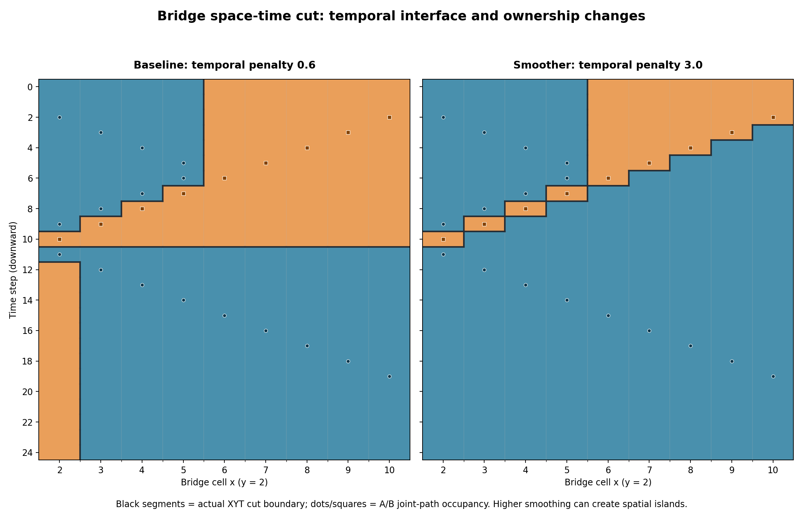
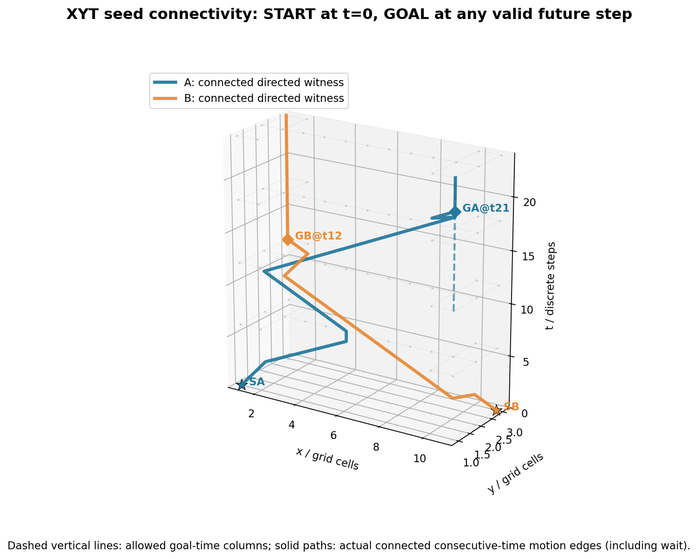
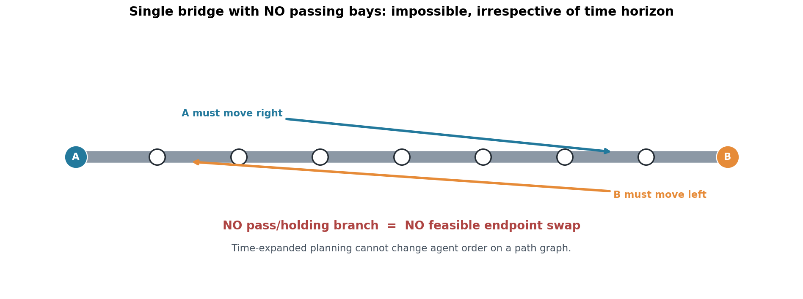

# Connected XYT Graph Cut: two corridors and single-lane bridge

An experimental follow-up to `step_scaled_horizon.py`, designed to answer three research questions:

1. **Seed reachability** — are both robots connected through permitted **directed** `(x,y,t) -> (x',y',t+1)` moves from their Start at `t=0` to their respective Goal at any subsequent time?
2. **Moving cut boundary** — how does the XY boundary (ridge) of the binary space-time labeling change for each discrete time step?
3. **Single-lane bridge** — what changes if crossing requires time-sharing instead of a spatial detour? Can a bridge without passing/holding spaces ever allow two robots to exchange endpoints?

> **Research prototype, not a UAV collision avoidance system.** Coordinates are discrete cells, `t` advances exactly one step per move or wait, goal occupancy is absorbing, and collision exclusion covers simultaneous vertex occupation and head-on edge swaps. Robot footprint, swept volume, position uncertainty, and continuous-time collisions are **not** modeled.

## How to reproduce

From the repository root, with Python 3.10+:

```sh
python -m pip install -r requirements.txt
python experiments/connected_cut_bridge.py --factor 2
python experiments/render_connected_cut.py
python -m pytest -q
```

- All experiment records, time-slice labels, path witnesses, and forward/backward reachability cores are exported to `output/connected_cut/report.json`.
- Figures, two all-time-slice GIFs, a smoothed-cut GIF, and a standalone HTML time-slider explorer are generated in `docs/figures/`.
- `docs/figures/cut_boundary_explorer.html` works offline in a browser; switch scenarios and scrub through `t`.

## Correct interpretation of the two graphs

**Movement graph:** each agent travels along directed edges between adjacent time layers. Allowed actions are move one orthogonal cell or wait, both with `Delta t = 1`. Goal is an absorbing state; upon reaching it the agent stays there in the model.

**Graph-cut labeling graph:** each XYT cell has a source-side A or sink-side B label and is linked via symmetric spatial and temporal smoothing edges. These are not long-distance robot motion edges. The terminals `source_A` and `sink_B` are *binary label terminals*, **not** the physical robot Start and Goal nodes.

The unique physical Start seeds are `s_A=(p_A,0)` and `s_B=(p_B,0)`. Since reaching the goal at any `t <= H` is equivalent to waiting at it until time `H`, the hard terminal goal seeds are `(g_A,H)` and `(g_B,H)` only. Intermediate goal-time cells are **not** automatically hard pinned. The vertical dashed goal-time lines in the XYT figure depict possible arrival times, not direct edges from the Start.

The plain min-cut objective is:

```text
E(L) = sum_v D_v(L(v))
     + lambda_xy * sum_spatial_neighbors [L(u) != L(v)]
     + lambda_t  * sum_temporal_neighbors [L(u) != L(v)]
```

`D_v` contains each robot's global D* Lite cost-to-go and a source-to-cell shortest-distance term. Source/Sink terminal pins enforce only the **label** of the starts/goals. **They do not enforce directed source-to-goal reachability.**

For a reproducible *connected-seed* result:

1. Two-agent **joint A\*** first finds a collision-free pair of time-indexed routes on the full map. It minimizes **sum of arrival steps**, with neither corridor reservation nor a fixed agent order.
2. These routes are used as **hard XYT witness pins** in the binary min cut (this makes feasibility explicit, rather than attributing it to the cut).
3. Each agent is independently replanned on the directed time-expanded graph constrained to its allotted labels, and the two candidate paths are conflict-checked.
4. A forward-from-Start / backward-from-Goal directed-reachability intersection classifies the *viable core*: nodes known to lie on **some** Start–Goal walk. Pale cells in the GIF are merely labeled; they are *not* certified to be usable.

**Important:** The pinned paths guarantee a directed Start–Goal walk exists for both robots within the allocated labels. They do **not** guarantee that **every** A/B-labeled node is part of a connected, navigable region. Full connected partition optimization is still open research.

## Results on the deterministic toy scenarios

| Scenario | Max independent shortest | XYT horizon (2x) | Plain binary cut | Path-witness-seeded cut / joint A* |
|---|---:|---:|---|---|
| Two corridors | A=14, B=16 | 32 | A reachable, B disconnected | A upper=14, B bypass=20; no vertex/swap conflicts |
| Bridge with holding/exit bays | A=12, B=12 | 24 | A reachable, B disconnected | A=21, B=12; both connected; no vertex/swap conflicts |
| Bridge with **no** bays | A=8, B=8 | 16 | A reachable, B disconnected | **Infeasible** for swapping endpoints; no joint paths |

On the bridge with bays, a small **secondary** tie bias favoring earlier A arrival changes the schedule to A=12, B=21, while favoring B gives A=21, B=12. Both have the same sum of arrivals (=33). This is not exclusive bridge reservation or a hard priority; it only breaks otherwise equal-cost solutions. With no preference, the solver's deterministic tie order chooses B first.

The `bridge_no_bays` case is fundamentally impossible for opposite robots swapping endpoints on a simple path graph **regardless of horizon**, under discrete vertex and head-on-swap exclusion. The robots cannot reverse their relative order unless a passing/holding branch or some other capacity/release operation exists.

## Moving boundary / twisting interface



The first panel is the baseline (`lambda_t = 0.6`), and the second uses greater time-direction smoothing (`lambda_t = 3.0`). The black XYT interface moves as the agents pass each other in time.

- At low temporal penalty, the boundary may **jump abruptly** across the entire bridge in a single step.
- With a higher temporal penalty, the interface can change more gradually. In this example, the maximum number of bridge cells switching labels in one step fell to 2, but **7 time slices** had more than one XY label transition along the central bridge. This is a direct example of why lower interface variation **does not guarantee connected spatial slices**.
- The blue/orange path dots on the X–T plot are computed joint A* trajectories, not hypothetical routes.

The same visualization is also available as a full discrete-time GIF:

- [Bridge cut animation](../docs/figures/bridge_cut.gif)
- [Bridge with smoother temporal interface](../docs/figures/bridge_smooth_cut.gif)
- [Two-corridor cut animation](../docs/figures/two_corridors_cut.gif)
- [Offline HTML time slider](../docs/figures/cut_boundary_explorer.html)

## Start and Goal terminal connectivity



Solid lines are actual *consecutive-time movement or wait edges*; dashed vertical lines are admissible goal-time columns. Neither cut terminal is a physical robot coordinate. Connection between the two physical seed pairs is checked by graph search, not presumed from the existence of the graph-cut assignment.

## Why no holding bays cannot work



A simple one-cell-wide line has an invariant left-to-right ordering for two agents if same-cell occupancy and opposing edge swaps are disallowed. Merely increasing `H` cannot change their order.

## Next research questions

- Replace *joint-path-witness-before-cut* with a **connectivity-constrained cut / mixed-integer flow** that jointly optimizes path feasibility and region partition. Compare with the current witness-seeded heuristic.
- Constrain disconnected XY islands and unviable XYT labels without introducing over-conservative reservations; compare temporal boundary smoothness vs region viability.
- Generalize tie-breaking, bridge occupancy, waiting and turn-back penalties so that anticipatory retreat is not confused with physically desirable behavior.
- Add continuous geometry, robust space/time separation margins, multiple time resolutions, and eventually `XYHT` / BST-ID if hierarchical indexing is useful.
- Compare joint A*, prioritized A*, CBS/WHCA*, and the proposed connected-area solver on cases beyond the tiny two-agent demonstration.
